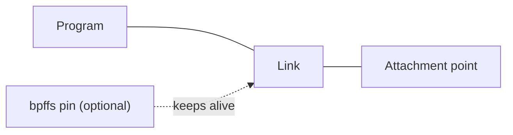

# Attaching Programs

Loading a Program with {{ godoc('NewCollection') }} or {{ godoc('NewProgram') }}
loads its instructions into the kernel, but does not attach it to a hook.
Package [`link`](https://pkg.go.dev/github.com/cilium/ebpf/link) provides APIs
for attaching loaded Programs to kernel and user space events. This page
covers attachments on Linux; see [Loading Objects](loader.md) for loading.

For an attachment managed through a Link:

Pinning is available only where the attachment mechanism supports it.

## The {{ godoc('link/Link') }} Abstraction

{{ linux_version("5.7", "Pinnable BPF links were introduced in Linux 5.7.") }}

A Link represents the attachment of a Program to a hook. Where supported,
{{ proj }} uses the kernel's `bpf_link` object, whose lifetime is managed
through file descriptors and bpffs pins. Older attachment mechanisms are
also exposed through the {{ godoc('link/Link') }} interface.

For example, given a loaded XDP Program named `prog`, attach it to `eth0`:

{{ go_example('DocAttachXDP', title='Attach an XDP Program to a network interface') }}

The deferred `Close()` detaches when the enclosing function returns. Keep the
function running while the attachment is needed, or return the Link to a
caller that manages its lifetime.

### Backwards Compatibility

{{ godoc('link/AttachCgroup') }} falls back to `BPF_PROG_ATTACH` on kernels
without BPF link support. Single kprobes, uprobes, and tracepoints use perf
events, falling back to `PERF_EVENT_IOC_SET_BPF` without perf-event BPF links.
Probe creation can also fall back to tracefs. Raw tracepoints on kernels
predating pinnable BPF links are represented by plain file descriptors.

These legacy Links cannot be pinned. Unsupported operations may return an
error wrapping {{ godoc('link/ErrNotSupported') }}. Fallbacks are specific to
each helper: for example, `AttachXDP` requires XDP BPF link support and does
not fall back to Netlink.

## Link Lifecycle

Not every Link supports every operation. Consult the API documentation for
the attachment type and handle errors from the following methods:

| Method | Behaviour |
| :--- | :--- |
| {{ godoc('link/Link.Close', short=True) }} | Releases resources. A kernel BPF link detaches when its last reference, including any pins, is released. |
| {{ godoc('link/Link.Pin', short=True) }} | Pins the Link to bpffs, preserving the attachment after `Close()` and process exit. |
| {{ godoc('link/Link.Unpin', short=True) }} | Removes the pin; other references can keep the Link alive. |
| {{ godoc('link/Link.Update', short=True) }} | Atomically replaces the attached Program, where supported. |
| {{ godoc('link/Link.Detach', short=True) }} | Detaches even if references remain, where supported. Still call `Close()` to release resources. |
| {{ godoc('link/Link.Info', short=True) }} | Returns link metadata; methods on {{ godoc('link/Info') }} expose hook-specific details. |

!!! warning ""
    Keep the Link reachable while it is needed. Garbage collection can close
    its underlying file descriptors and detach the Program. Use
    `#!go defer l.Close()` or retain the Link and close it during shutdown.
    Some legacy attachments, such as the cgroup fallback, persist if `Close()`
    is not called.

Closing a Program's file descriptor does not detach it. Pinning a Program
keeps it loaded, but does not preserve its Link: pin the Link itself for that.
Reopen a pinned Link with {{ godoc('link/LoadPinnedLink') }}. Pins do not survive
a reboot. See [Object Lifecycle](object-lifecycle.md) for more detail.

## Targets

A Program's type and attach type must match the hook. {{ proj }} normally
derives these from the ELF [section name](section-naming.md). A target in a
section name does not automatically attach the Program.

- **Link-time targets**: Supply interface indices, cgroup paths, probe symbols,
  or tracepoint names to the corresponding attach helper. Some Programs also
  need target-specific information at load time, such as
  {{ godoc('ProgramSpec.Ifindex') }} for device-bound network Programs.
- **Load-time targets**: BTF tracing and LSM Programs use
  {{ godoc('ProgramSpec.AttachTo') }} to identify their target during loading.
  Iterators use the `Tracing` program type with `AttachTraceIter`; `AttachTo`
  selects the kind of iterator. Some hooks also need a resource at link time:
  {{ godoc('link/IterOptions') }} can select a Map, and cgroup-scoped LSM
  Programs use {{ godoc('link/AttachCgroup') }} to select a cgroup.
- **Other eBPF Programs**: For `freplace`, set
  {{ godoc('ProgramSpec.AttachTarget') }} and `AttachTo` before loading. Then
  call {{ godoc('link/AttachFreplace') }} with `nil` and `""` as the first two
  arguments to use that target. Tracing another Program with `fentry` or
  `fexit` also uses `AttachTarget` and `AttachTo` at load time.
- **Struct Ops**: Callback Programs are verified against kernel BTF at load
  time. Attach a {{ godoc('StructOpsMap') }} loaded from a `.struct_ops.link`
  definition using {{ godoc('link/AttachStructOps') }}.

## Supported Hooks

The following helpers cover common attachment types. Kernel support and
required privileges vary by hook; consult the API reference and
[Feature Detection](features.md) when supporting different systems.

| Hook | API | Target |
| :--- | :--- | :--- |
| XDP | {{ godoc('link/AttachXDP') }} | Network interface (BPF links require Linux 5.9+) |
| TCX | {{ godoc('link/AttachTCX') }} | Network interface, ingress or egress (Linux 6.6+) |
| Netkit | {{ godoc('link/AttachNetkit') }} | Netkit device, primary or peer hook (Linux 6.7+) |
| Netfilter | {{ godoc('link/AttachNetfilter') }} | Protocol family, hook, and priority (Linux 6.4+) |
| Network namespaces | {{ godoc('link/AttachNetNs') }} | Namespace file descriptor; `FlowDissector` or `SkLookup` Program |
| Cgroups | {{ godoc('link/AttachCgroup') }} | Cgroup v2 path and attach type |
| Kprobes / Kretprobes | {{ godoc('link/Kprobe') }}, {{ godoc('link/Kretprobe') }} | Kernel function |
| Multi-Kprobes | {{ godoc('link/KprobeMulti') }}, {{ godoc('link/KretprobeMulti') }} | Multiple kernel functions |
| Uprobes / Uretprobes | {{ godoc('link/Executable.Uprobe') }}, {{ godoc('link/Executable.Uretprobe') }} | Location in an executable or shared object |
| Multi-Uprobes | {{ godoc('link/Executable.UprobeMulti') }}, {{ godoc('link/Executable.UretprobeMulti') }} | Multiple user space locations |
| Tracepoints | {{ godoc('link/Tracepoint') }} | Tracepoint group and name |
| Raw tracepoints | {{ godoc('link/AttachRawTracepoint') }} | Raw tracepoint name |
| BTF tracing | {{ godoc('link/AttachTracing') }} | Load-time target for `fentry`, `fexit`, `fsession`, `fmod_ret`, or `tp_btf` |
| LSM | {{ godoc('link/AttachLSM') }} | LSM hook with `AttachLSMMac`; use `AttachCgroup` for `AttachLSMCgroup` |
| Program extensions | {{ godoc('link/AttachFreplace') }} | Function in another eBPF Program |
| Iterators | {{ godoc('link/AttachIter') }} | Iterator kind selected at load time; optional Map |
| Struct Ops | {{ godoc('link/AttachStructOps') }} | Struct Ops Map |

### Multi-Program Ordering

TCX and Netkit support ordering with {{ godoc('link/Anchor') }}. For example,
use {{ godoc('link/Head') }}, {{ godoc('link/Tail') }}, or
{{ godoc('link/BeforeLink') }} to choose a position. Query the target's attached
Programs with {{ godoc('link/QueryPrograms') }} and pass its nonzero `Revision`
as `ExpectedRevision` to reject concurrent changes with `ESTALE`.

Given two loaded TCX ingress Programs and an interface index, insert `progB`
before `progA`:

{{ go_example('DocTCXAnchor', title='Order TCX Programs with Anchor and ExpectedRevision') }}

!!! note "Classic TC"
    Package `link` does not configure classic TC qdiscs or `cls_bpf` filters,
    regardless of kernel version. Configure them using a Netlink library and
    pass {{ godoc('Program.FD') }} as required by that library.

### User Space Tracing

Use {{ godoc('link/OpenExecutable') }} to select a file, then attach a loaded
uprobe Program (type `Kprobe`) to one of its symbols:

{{ go_example('DocAttachUprobe', title='Attach a uprobe to readline in /bin/bash') }}

This requires `/bin/bash` to define `readline`. If a shared library defines
the function instead, open that library's path. {{ proj }} does not resolve
an executable's imported symbols through the dynamic linker. To probe a known
location without a symbol, set `UprobeOptions.Address` to a nonzero absolute
file offset in the selected file and pass an empty symbol name (`""`).

### Iterators

Given a loaded iterator Program, attach it and read its output. Reading from
the `io.ReadCloser` returned by {{ godoc('link/Iter.Open') }} triggers the
Program. Close both the reader and the Link when finished:

{{ go_example('DocAttachIter', title='Read from a BPF iterator') }}

## Socket Filters and Low-Level Attachments

{{ godoc('link/AttachSocketFilter') }} attaches a `SocketFilter` Program to a
`syscall.Conn`. It returns an error, not a Link. Use
{{ godoc('link/DetachSocketFilter') }} to detach while keeping the socket open.

For hooks without a higher-level helper, {{ godoc('link/AttachRawLink') }}
wraps `BPF_LINK_CREATE`, and {{ godoc('link/RawAttachProgram') }} wraps
`BPF_PROG_ATTACH`. These mechanisms are not interchangeable: the hook and
kernel must support the chosen syscall. For example, use `RawAttachProgram`
to attach `SkSKB` or `SkMsg` Programs to a `SockMap` or `SockHash`.

`RawAttachProgram` does not return a Link. Closing the Program's file
descriptor does not undo the attachment; use
{{ godoc('link/RawDetachProgram') }} to detach it explicitly.
